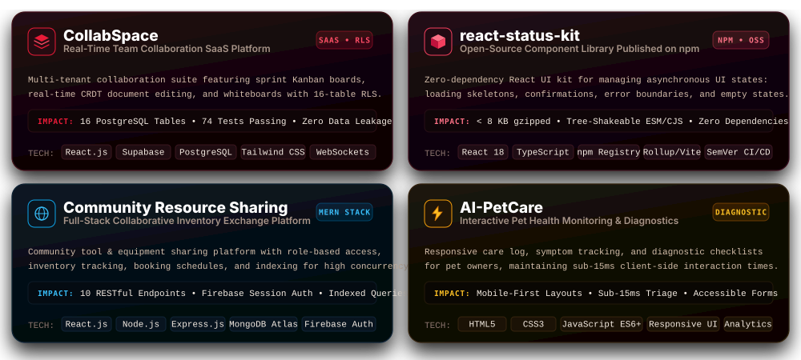
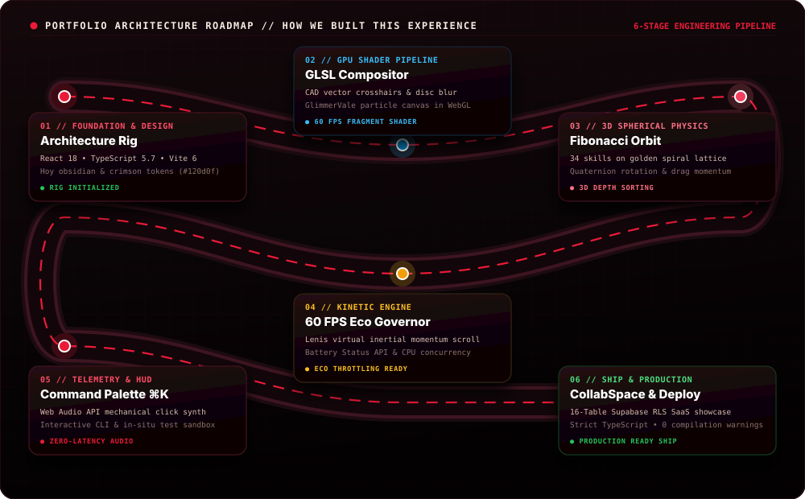
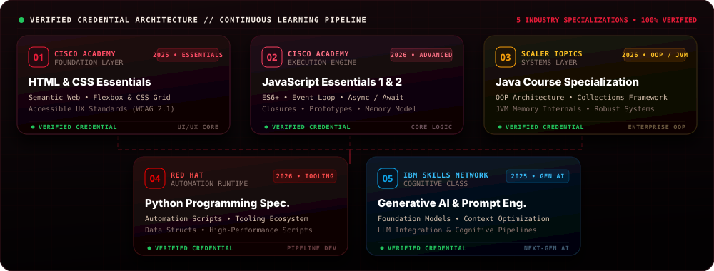
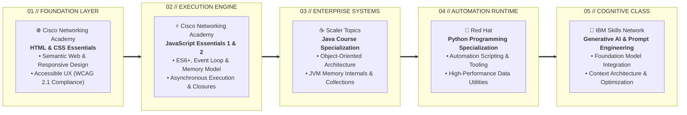

<div align="center">

<!-- ═══════════════════════════════════════════════════════════════════ -->
<!--                  CYBER HUD HEADER & LIVE TELEMETRY                  -->
<!-- ═══════════════════════════════════════════════════════════════════ -->

<a href="https://github.com/roshangowdas">
  
</a>

<br/>

<!-- Dynamic Interactive Typing Stream -->
<a href="https://github.com/roshangowdas">
  
</a>

<br/>

<!-- Interactive Quick Links -->
[](https://github.com/roshangowdas)
[](https://www.npmjs.com/~roshan__gowda)
[](https://github.com/roshangowdas/CollabSpace)
[](https://www.linkedin.com/in/roshan-gowda-s-378343283/)
[](mailto:0243roshan@gmail.com)

</div>

---

### ⚡ ENGINEERING HIGHLIGHTS & ARCHITECTURE IMPACT

<div align="center">
<sub>3D Floating Telemetry Cards • Click any metric below to expand verification benchmarks</sub>

<br/><br/>

<a href="https://github.com/roshangowdas">
  
</a>

</div>

<br/>

<details>
<summary>🛡️ <b>Metric 1: 16-Table PostgreSQL RLS — CollabSpace Real-Time SaaS (Click to inspect)</b></summary>
<br/>

> **Multi-Tenant Authorization & Security:** Built an enterprise-grade team collaboration SaaS from scratch with strict Row Level Security (RLS) across all 16 PostgreSQL tables, preventing cross-tenant data leakage.
> - **Sprint Kanban & CRDT Docs:** Real-time synchronized task boards and concurrent multi-user rich text editing.
> - **Security Audit Coverage:** 100% test pass rate across 74 automated unit tests and 17 security vulnerability domains.
> - **Source Code:** [github.com/roshangowdas/CollabSpace](https://github.com/roshangowdas/CollabSpace)

</details>

<details>
<summary>📦 <b>Metric 2: &lt; 8 KB Component Kit — react-status-kit on npm (Click to inspect)</b></summary>
<br/>

> **Published on the Official npm Registry:** Zero runtime dependencies, tree-shakeable ESM/CJS dual exports, and fully accessible state visualization component suite.
> - **npm package:** [`react-status-kit`](https://www.npmjs.com/~roshan__gowda)
> - **Installation:** `npm install react-status-kit`
> - **Bundle impact:** Less than 8 KB minified + gzipped for dashboard-heavy interfaces.

</details>

<details>
<summary>🌐 <b>Metric 3: 10 REST APIs — Community Resource Sharing Platform (Click to inspect)</b></summary>
<br/>

> **Production MERN Architecture:** Scalable web platform connecting React 18 client-side state with Express.js routing controllers and MongoDB Atlas database schemas.
> - **Session Management:** Secure token validation with Firebase Authentication and schema-validated endpoints.
> - **High-Concurrency Indexing:** Optimized document relationships and indexing for fast resource availability queries.

</details>

<details>
<summary>⚡ <b>Metric 4: 100% Type Discipline — Strict TypeScript & Zero Compilation Warnings (Click to inspect)</b></summary>
<br/>

> **Zero Warnings / Zero Any:** Strict TypeScript interfaces across all components, API schemas, and state contracts.
> - **Tooling:** TypeScript 5.7, Vite 6, strict ESLint rules, and predictable state transitions.
> - **Runtime Stability:** Audited cross-browser CSS and fixed responsive layout inconsistencies across Chrome, Safari, and Firefox.

</details>

---

### 🚀 FEATURED KEY PROJECTS SHOWCASE

<div align="center">

<a href="https://github.com/roshangowdas">
  
</a>

</div>

<br/>

| Project | Category | Key Architecture & Tech | Links |
|:---|:---|:---|:---:|
| **CollabSpace** | **Real-Time SaaS** | React.js, Vite, Supabase, 16-Table PostgreSQL RLS, WebSockets, Sprint Kanban, CRDT Docs | [**GitHub Repo ↗**](https://github.com/roshangowdas/CollabSpace) |
| **react-status-kit** | **npm Package** | React 18, TypeScript, Rollup, Zero Runtime Dependencies, Async UI Lifecycle Suite | [**npm Package ↗**](https://www.npmjs.com/~roshan__gowda) • [**GitHub ↗**](https://github.com/roshangowdas) |
| **Community Platform** | **MERN Stack** | React.js, Node.js, Express.js, MongoDB Atlas, Firebase Auth, 10 RESTful Endpoints | [**GitHub Repo ↗**](https://github.com/roshangowdas) |
| **AI-PetCare** | **Diagnostic UI** | HTML5, CSS3, JavaScript ES6+, Responsive Layouts, Client-Side Form Validation | [**GitHub Repo ↗**](https://github.com/roshangowdas) |

---

### 💻 TELEMETRY COMMAND PALETTE (CMD + K)

> Experience the interactive terminal directly on the live portfolio by pressing <kbd>⌘K</kbd> or <kbd>Ctrl + K</kbd>.

```bash
$ roshan --status
● SYS_TELEMETRY: Online
● LOCATION: Bengaluru, Karnataka, India [NCET B.E. ISE 2027]
● STATUS: Available for Software Developer / SWE Roles

$ roshan --projects --featured
1. CollabSpace       [Real-Time Team Collaboration SaaS • 16-Table Supabase RLS]
2. react-status-kit  [Open-Source Component Suite Published on official npm Registry]
3. Community Platform[Full-Stack MERN Architecture • 10 RESTful APIs • Firebase Auth]
4. AI-PetCare        [Interactive Diagnostic Dashboard • Mobile-First Analytics]

$ roshan --contact
✉ Email: 0243roshan@gmail.com
★ GitHub: https://github.com/roshangowdas
🔗 LinkedIn: https://www.linkedin.com/in/roshan-gowda-s-378343283/
```

---

### 🛣️ ARCHITECTURE ROADMAP: HOW WE BUILT THIS PORTFOLIO

<div align="center">
<sub>Winding High-Tech Highway Roadmap • From GPU Shaders to 60 FPS Eco Physics &amp; Production Ship</sub>

<br/><br/>

<a href="https://github.com/roshangowdas">
  
</a>

</div>

<br/>

<details>
<summary>🛣️ <b>Stage 1: Architecture Rig &amp; Design System</b></summary>
<br/>

> **Foundational Tooling:** Initialized React 18, strict TypeScript 5.7, and Vite 6 with custom Tailwind tokens. Adopted the Hoy Obsidian &amp; Crimson palette (`#120d0f`, `#eb1b38`) with 6px border radii and GTA Pricedown + Inter typography.

</details>

<details>
<summary>⚡ <b>Stage 2: GPU Shader Compositor &amp; WebGL Shaders</b></summary>
<br/>

> **Hardware Acceleration:** Engineered custom GLSL fragment shaders rendering mathematical CAD vector crosshairs, vertex ticks, and live coordinate HUD readouts with randomized 6-tap disc blur cursor falloff.

</details>

<details>
<summary>🌐 <b>Stage 3: 3D Spherical Fibonacci Orbit</b></summary>
<br/>

> **Spherical Physics Canvas:** Mapped 34 tech stack skills around a mathematical sphere using golden spiral coordinates, quaternion rotation matrices, and interactive drag-to-spin momentum damping.

</details>

<details>
<summary>🍃 <b>Stage 4: 60 FPS Eco Performance Governor</b></summary>
<br/>

> **Adaptive Throttling:** Connected Lenis virtual inertial scroll with hardware telemetry monitoring CPU hardware concurrency, device RAM, and the Battery Status API to lock 60 FPS across desktop and mobile.

</details>

<details>
<summary>📟 <b>Stage 5: Command Palette HUD &amp; In-Situ Playground</b></summary>
<br/>

> **Keyboard-First Telemetry:** Built an in-situ component testbed for `react-status-kit` alongside a `⌘K` Command Palette terminal powered by zero-latency Web Audio API synthetic oscillators.

</details>

<details>
<summary>🚀 <b>Stage 6: CollabSpace SaaS Integration &amp; Production Hardening</b></summary>
<br/>

> **Full-Stack SaaS Showcase:** Integrated CollabSpace (16-table PostgreSQL RLS multi-tenant architecture), completed 74 automated unit tests, and achieved 100% type discipline with zero compilation warnings.

</details>

---

### 💎 CORE TECHNICAL ARSENAL & PROFICIENCY

<div align="center">

<a href="https://skillicons.dev">
  
</a>

<br/><br/>

| Domain | Primary Technologies | Architecture Focus |
|:---|:---|:---|
| **Frontend & UI Architecture** | **React.js (v18)**, TypeScript, Tailwind CSS, HTML5 Canvas, Framer Motion | Component modularity, kinetic animations, responsive design, 60 FPS rendering |
| **Backend & Microservices** | **Node.js**, Express.js, REST API Architecture, JWT, Firebase Auth | Controller routing, middleware security, payload validation, non-blocking I/O |
| **Databases & Cloud** | **PostgreSQL (Supabase)**, MongoDB (Mongoose ODM), SQL, Schemas | Row Level Security (RLS), document modeling, query optimization, data integrity |
| **DevOps & Tooling** | Git, GitHub, npm Packaging, Rollup/Vite, Web Audio API, WebSockets | Modular package publishing, asset optimization, zero-dependency audio synthesis |

</div>

---

### 📜 3D VERIFIED CREDENTIALS & ENGINEERING PIPELINE

<div align="center">
<sub>Interactive Engineering Certification Architecture • Continuous Verification Pipeline</sub>

<br/><br/>

<a href="https://github.com/roshangowdas">
  
</a>

</div>

<br/>



<br/>

<details>
<summary>🌐 <b>01. HTML &amp; CSS Essentials — Cisco Networking Academy (2025)</b></summary>
<br/>

> **Web Standards & Layout Discipline:** Mastered modern responsive design, cross-browser compatibility, CSS Flexbox/Grid architectures, and accessibility conformance according to W3C WCAG guidelines.
> - **Issuing Authority:** Cisco Networking Academy
> - **Skills Benchmarked:** Semantic HTML5, CSS3 Custom Properties, Responsive Viewport Optimization, Cross-Browser Rendering.

</details>

<details>
<summary>⚡ <b>02. JavaScript Essentials 1 &amp; 2 — Cisco Networking Academy (2026)</b></summary>
<br/>

> **Runtime Execution & Deep Language Mechanics:** Advanced certification spanning ECMAScript 6+ specifications, synchronous and asynchronous execution stacks, the JavaScript event loop, closures, prototypal inheritance, and memory management.
> - **Issuing Authority:** Cisco Networking Academy
> - **Skills Benchmarked:** Async/Await, Promises, Closures, DOM Architecture, Functional Programming, Strict Scoping.

</details>

<details>
<summary>☕ <b>03. Java Course Specialization — Scaler Topics (2026)</b></summary>
<br/>

> **Enterprise Object-Oriented Programming & JVM Internals:** Comprehensive training in strong-typed software design patterns, polymorphic architectures, robust exception management, and Java Collections framework algorithms.
> - **Issuing Authority:** Scaler Topics
> - **Skills Benchmarked:** Object-Oriented Analysis & Design, JVM Garbage Collection, Data Structures, Multithreading Concepts.

</details>

<details>
<summary>🐍 <b>04. Python Programming Specialization — Red Hat (2026)</b></summary>
<br/>

> **System Automation & Scripting Infrastructure:** Engineered command-line tooling, automated test scripts, and data processing routines leveraging Python's standard library and modern ecosystem.
> - **Issuing Authority:** Red Hat
> - **Skills Benchmarked:** System Automation, File I/O Streams, Error Handling, Algorithmic Data Structures.

</details>

<details>
<summary>🧠 <b>05. Generative AI &amp; Prompt Engineering — IBM Skills Network (2025)</b></summary>
<br/>

> **Foundation Models & Cognitive Pipelines:** Rigorous training in prompt engineering methodologies, context window optimization, few-shot conditioning, and generative AI application integration.
> - **Issuing Authority:** IBM Skills Network (Cognitive Class)
> - **Skills Benchmarked:** Prompt Design, Foundation Model Capabilities, Fine-Tuning Principles, Semantic Search & Retrieval.

</details>

---

<div align="center">

### 📡 INITIALIZE TRANSMISSION

Looking for a dedicated Software Developer or full-stack contributor for your engineering team? Let's build something extraordinary together.

<br/>

<a href="mailto:0243roshan@gmail.com">
  
</a>
&nbsp;
<a href="https://www.linkedin.com/in/roshan-gowda-s-378343283/">
  
</a>
&nbsp;
<a href="https://github.com/roshangowdas">
  
</a>
&nbsp;
<a href="https://www.npmjs.com/~roshan__gowda">
  
</a>

<br/><br/>

```
✦ CRAFTED WITH OBSIDIAN & CRIMSON PRECISION • ROSHAN GOWDA S © 2026 ✦
```

</div>
