<div align="center">

```
  ██████╗  ██████╗ ███████╗██╗  ██╗ █████╗ ███╗   ██╗     ██████╗  ██████╗ ██╗    ██╗██████╗  █████╗ 
  ██╔══██╗██╔═══██╗██╔════╝██║  ██║██╔══██╗████╗  ██║    ██╔════╝ ██╔═══██╗██║    ██║██╔══██╗██╔══██╗
  ██████╔╝██║   ██║███████╗███████║███████║██╔██╗ ██║    ██║  ███╗██║   ██║██║ █╗ ██║██║  ██║███████║
  ██╔══██╗██║   ██║╚════██║██╔══██║██╔══██║██║╚██╗██║    ██║   ██║██║   ██║██║███╗██║██║  ██║██╔══██║
  ██║  ██║╚██████╔╝███████║██║  ██║██║  ██║██║ ╚████║    ╚██████╔╝╚██████╔╝╚███╔███╔╝██████╔╝██║  ██║
  ╚═╝  ╚═╝ ╚═════╝ ╚══════╝╚═╝  ╚═╝╚═╝  ╚═╝╚═╝  ╚═══╝     ╚═════╝  ╚═════╝  ╚══╝╚══╝ ╚═════╝ ╚═╝  ╚═╝
```

<!-- Dynamic Typing SVG Banner -->
<a href="https://github.com/roshangowdas">
  
</a>

<br/>

[](https://github.com/roshangowdas)
[](https://www.npmjs.com/~roshan__gowda)
[](https://www.linkedin.com/in/roshan-gowda-s-378343283/)
[](mailto:0243roshan@gmail.com)

<br/>

<!-- 3D Animated Hero Header Banner -->


</div>

---

<div align="center">

### 🚀 ENGINEERING HIGHLIGHTS & IMPACT

| 📦 **< 8 KB Component Kit** | 🌐 **5+ Production Web Apps** | 🎯 **-20% Inconsistencies** | ⚡ **100% Type Discipline** |
|:---:|:---:|:---:|:---:|
| Authored & published `react-status-kit` on npm | Full-stack MERN applications shipped | Cross-browser layout & responsive audits | Strict TypeScript & modular architecture |

</div>

---

## 📐 3D ANIMATED ARCHITECTURE: HOW WE BUILT THIS PORTFOLIO

The portfolio was engineered from the ground up as a multi-layered, GPU-composited web experience designed to lock at **60 FPS** on desktop and mobile while executing real-time fragment shaders, dynamic spherical canvas projections, kinetic rubberband physics, and synthesized audio.

```mermaid
flowchart TD
    subgraph L1["LAYER 1: GPU WEBGL & SHADER COMPOSITOR"]
        CAD["GLSL Fragment Shader<br/>• CAD Vector Wireframe Rig<br/>• Dot-Matrix Typography Mesh<br/>• 6-Tap Radial Disc Blur Reach<br/>• Idle Radar Sweep Generator"]
        Glimmer["GlimmerVale WebGL Canvas<br/>• Obsidian Night Meadow Shader<br/>• High-Density GPU Sparkle Field"]
    end

    subgraph L2["LAYER 2: 3D SPHERICAL ORBIT ENGINE"]
        Sphere["HTML5 Canvas 3D Sphere<br/>• Fibonacci Spherical Lattice Distribution<br/>• Quaternion Rotation & Velocity Drag<br/>• Real-Time Z-Depth Alpha & Scale Sorting"]
        Matrix["Skill Matrix Projection<br/>• Dual View Switcher (Orbit ⟷ Matrix)<br/>• Categorized Proficiency Tracks"]
    end

    subgraph L3["LAYER 3: 60FPS ECO & KINETIC GOVERNOR"]
        Lenis["Lenis Momentum Scroll<br/>• Virtual Smooth Inertial Scroll"]
        GSAP["GSAP ScrollTrigger Scrubbing<br/>• Multi-Depth Parallax Timelines"]
        Eco["Battery & Hardware Telemetry<br/>• Battery Status API Monitoring<br/>• prefers-reduced-motion Detection<br/>• Dynamic Particle Scaling Governor"]
    end

    subgraph L4["LAYER 4: IN-SITU RUNTIME & HUD TERMINAL"]
        Sandbox["In-Situ Component Sandbox<br/>• react-status-kit Live Testbed<br/>• Lifecycle State Simulation Engine"]
        HUD["Command Palette Terminal (Cmd + K)<br/>• Keyboard Navigation System<br/>• Web Audio API Click Synthesizer"]
    end

    subgraph L5["LAYER 5: REACT BITS KINETIC LAUNCHER"]
        Sling["SlingButton Slingshot Launcher<br/>• Pointer Capture & Tension Calculation<br/>• Dynamic SVG Band Deformation<br/>• Upward Particle Scatter & Smooth Scroll"]
    end

    L1 --> L2
    L2 --> L3
    L3 --> L4
    L4 --> L5
```



<br/>

### 🔬 Architecture Deep Dive

<table>
<tr>
<td width="50%" valign="top">

#### 1. GPU Shader Compositor
- **Vector Wordmark Rig:** Custom GLSL fragment shader rendering mathematical CAD vector crosshairs, vertex ticks, and live coordinate HUD readouts `[gx, gy]`.
- **Dynamic Mouse Reach:** Cursor radius evaluates a 6-tap randomized disc blur algorithm that unveils crisp dot-matrix typography underneath with silky falloff.
- **Atmospheric Glimmer:** Real-time WebGL shader background featuring night-meadow particle fields tuned in Crimson (`#eb1b38`) & Obsidian.

</td>
<td width="50%" valign="top">

#### 2. 3D Spherical Physics Orbit
- **Fibonacci Point Distribution:** 34 tech stack items arranged around a mathematical sphere using golden spiral coordinates.
- **Momentum Physics:** Interactive drag-to-spin with inertia damping, quaternion rotation matrices, and depth sorting (`z-index` and scale mapping from `0.6x` to `1.0x`).
- **Dual View Mode:** Instant toggle between 3D orbital space and an analytical grouped Skill Matrix view.

</td>
</tr>
<tr>
<td width="50%" valign="top">

#### 3. 60 FPS Eco Performance Governor
- **Hardware Telemetry:** Hook continuously reads CPU hardware concurrency, device RAM, and the Battery Status API.
- **Eco Throttling:** Automatically drops particle densities and damps GSAP parallax scrub multipliers when on low battery (`< 20%`) or when `prefers-reduced-motion` is active.
- **Lenis Momentum Sync:** Decoupled virtual scroll ticker integrated seamlessly with GSAP `ScrollTrigger.update`.

</td>
<td width="50%" valign="top">

#### 4. React Bits Slingshot & Audio Synthesizer
- **Kinetic SlingButton:** Interactive footer launcher utilizing pointer capture, elastic band deformation via cubic bezier paths, and tension arming at 28px pull.
- **Particle Burst:** On release, launches an upward cone of 14 crimson physics dots and initiates smooth window scroll.
- **Synthetic Web Audio:** Zero-download Web Audio API oscillator synthesizing mechanical click audio with sub-1ms latency.

</td>
</tr>
</table>

---

## 💎 CORE TECHNICAL ARSENAL

<div align="center">

#### ⚡ 3D INTERACTIVE TECH RADAR

<a href="https://skillicons.dev">
  
</a>

<br/><br/>

| Domain | Primary Technologies | Architecture Focus |
|:---|:---|:---|
| **Frontend & UI Architecture** | **React 18**, TypeScript, Tailwind CSS, HTML5 Canvas, GSAP, Framer Motion | Component modularity, kinetic animations, responsive design, 60 FPS rendering |
| **Backend & Microservices** | **Node.js**, Express.js, REST API Architecture, JWT, Firebase Auth | Controller routing, middleware security, payload validation, non-blocking I/O |
| **Databases & Cloud** | **MongoDB (Mongoose ODM)**, SQL, Schemas, Firebase Cloud | Document modeling, aggregation pipelines, query optimization, data integrity |
| **DevOps & Tooling** | Git, GitHub, npm Packaging, Rollup/Vite, Web Audio API, WebGL Shaders | Modular package publishing, asset optimization, zero-dependency audio synthesis |

</div>

---

<div align="center">

### 📡 INITIALIZE TRANSMISSION

Looking for a dedicated Software Developer or full-stack contributor? Let's build something extraordinary together.

<br/>

<a href="mailto:0243roshan@gmail.com">
  
</a>
&nbsp;
<a href="https://www.linkedin.com/in/roshan-gowda-s-378343283/">
  
</a>
&nbsp;
<a href="https://github.com/roshangowdas">
  
</a>
&nbsp;
<a href="https://www.npmjs.com/~roshan__gowda">
  
</a>

<br/><br/>

```
✦ CRAFTED WITH OBSIDIAN & CRIMSON PRECISION • ROSHAN GOWDA S © 2026 ✦
```

<!-- Dynamic Wave Footer Banner -->


</div>
